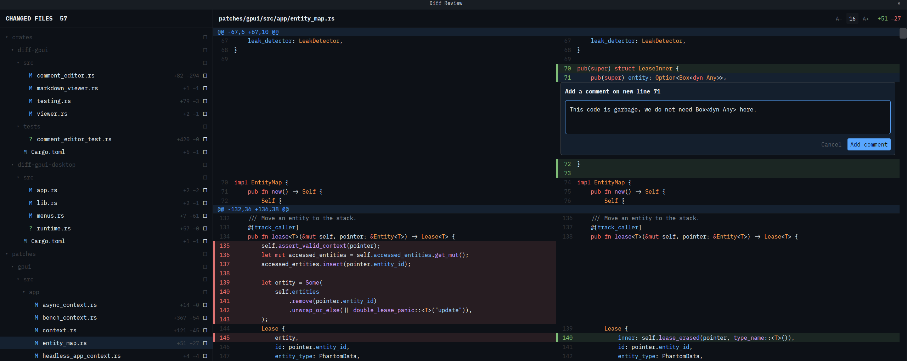

# ClankerDiff

Clankerdiff is a beautiful diff-viewer that lets you send PR-style comments to your coding agent. It runs on the desktop, in the terminal and on the web.



For **macOS (Apple Silicon)** and **Linux (x86_64 / ARM64)**:

```sh
curl --proto '=https' --tlsv1.2 -LsSf https://github.com/jcarver989/diff/releases/download/clankerdiff-cli-v0.3.2/clankerdiff-cli-installer.sh | sh
```

See the [ClankerDiff README](crates/diff/cli/README.md) for usage, the agent skill and keyboard shortcuts.

## Repository layout

This repository also holds the Rouge building blocks ClankerDiff is made of, which other apps use too. Crates are grouped by domain under `crates/`:

| Domain | Crates | What's there |
| --- | --- | --- |
| `util/` | `fingerprint`, `remote` | General-purpose crates with no UI and no diff concepts. |
| `ui/` | `core`, `syntax` | Themes and syntax highlighting. |
| `diff/` | `core`, `protocol`, `client`, `git`, `watch`, `server`, `markdown`, `rouge`, `ratatui`, `cli`, `desktop`, `web` | The diff and markdown review domain, its renderers and the ClankerDiff apps. |

A crate may depend only on its own domain or a lower one (`util` < `ui` < `diff`), which `just layer-check` enforces. See [AGENTS.md](AGENTS.md) for conventions.

## Building the migration branch

The checked-in sources are midway through a [hard cutover to Rouge](migration-plan.md). The desktop and browser targets do not build yet; the release linked above predates the cutover. For a headless build, use `cargo build -p clankerdiff-cli --no-default-features`.

All workspace commands require Rust 1.99.1 and a sibling `../rouge` checkout. From the Diff root, run `bash .github/scripts/checkout-rouge.sh` to check out the exact revision pinned in `.framer/src/lib.rs`. The script will not replace an existing checkout. The phase 2 browser skeleton revision must be pushed to the Rouge remote before a fresh clone or hosted CI can fetch it.

Graphical crates use local Rouge dependencies and cannot be published to crates.io during the migration. Local binary packaging still uses cargo-dist, but graphical releases must wait for the port and acceptance checks. Downstream consumers must adopt the renamed crates and Rouge APIs; the rename alone does not port their UI code.

The shared design system (`rouge-widgets`) and its renderer-neutral theme types (`rouge-theme`) live in the Rouge repository. Run the component gallery from the Diff root with a graphical session:

```sh
cargo run --manifest-path ../rouge/Cargo.toml -p rouge-widgets --example component_gallery
```

For a native presentation smoke test, set `ROUGE_EXIT_AFTER_FRAMES=4` before the command. The gallery is the only shared-crate target that uses the native Rouge application facade; the library can be checked for `wasm32-unknown-unknown` independently.
