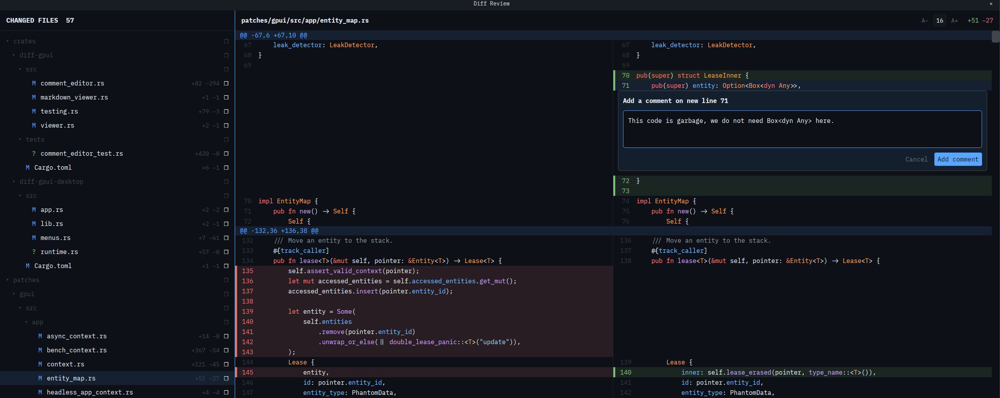
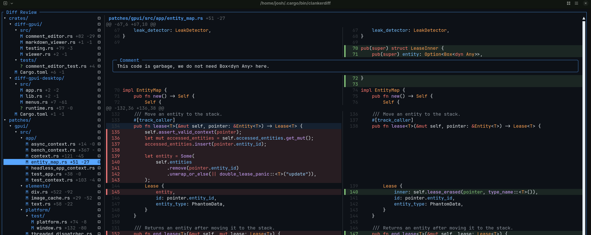

# ClankerDiff

Clankerdiff is a beautiful diff-viewer that lets you send PR-style comments to your coding agent.

### Desktop



### TUI



What makes ClankerDiff special?:

- It's written in Rust (blazing fast!)
- It's multi-surface (Terminal, Desktop and Web). 
- It's local _and_ remote (e.g. view a git diff on machine A via a local client on machine B)  
- It offers AST-powered syntax highlighting and theme support.
- It has vim-style keyboard shortcuts and git commit support built-in

## How do I install it?

For **macOS (Apple Silicon)** and **Linux (x86_64 / ARM64)**:

```sh
curl --proto '=https' --tlsv1.2 -LsSf https://github.com/jcarver989/diff/releases/download/clankerdiff-cli-v0.3.2/clankerdiff-cli-installer.sh | sh
```
Prefer a manual install? Grab a binary from [Releases](https://github.com/jcarver989/diff/releases).

## How do I use it?

1. You or your agent invoke the `clankerdiff` CLI
2. It blocks while you review the diff
3. Submit your comments, `clankerdiff` exits, prints your comments to stdout and your agent addresses your feedback

### Manually

**Desktop**
```bash
clankerdiff review . --ui desktop --scope both --format json
```

**TUI** 
```bash
CLANKERDIFF_TUI_COMMAND='ghostty +new-window -e' clankerdiff review . --ui tui --tui-placement external --scope both --format json
```

Note: `CLANKERDIFF_TUI_COMMAND` changes based on your terminal of choice. In the example above, this command tells Ghostty to open clankerdiff in a new terminal window.

**Commit by commit**

On a branch, the review pages through each commit since it diverged from `origin/HEAD` (or `origin/main`, `origin/master`, `main`, `master`), followed by your uncommitted changes. Press `[` / `]` to move between pages, `{` / `}` to jump to the first commit or your uncommitted changes, or `p` to pick a page from a list; comments on commits are grouped by commit in the feedback. Add `--commits` to start on the oldest commit, like a pull request.

```bash
clankerdiff review . --ui desktop --scope both --format json --commits
```

### Skill 

If your harness supports bash interpolation within `SKILL.md` files, you can create a user invocable skill (e.g. `/diff`) that calls `clankerdiff` and sends feedback straight to your agent. For example:

```markdown
---
name: diff
description: Review current changes in the desktop Diff UI and submit feedback
user-invocable: true
agent-invocable: false
---

The user reviewed the current workspace changes.

Interpret the review result below:
- changes_requested: address the user's submitted comments.
- approved: acknowledge approval without making additional changes.
- cancelled: do not make changes.
- If the result is missing or invalid, report that no review result was received.
  Do not infer approval or make changes based on missing feedback.

Do not launch another review automatically.

Review result:

!`clankerdiff review . --ui desktop --scope both --format json`
```

If your harness _doesn't_ support this, you might feel like a sad panda. If you do, checkout [aether](https://aether-agent.io), which is also written in Rust and has clankerdiff built-in.

### Keyboard shortcuts

Select a file, move to a line, and press `c` (or click the `+` in the line's gutter) to add a comment.
When you’re done, press `s` in the diff pane or click Submit to send it. The agent receives your
comments and addresses them. Press `y` or click Copy to copy the feedback instead.

The terminal and desktop apps share one set of shortcuts. Everything else lives in the toolbar and in
the command list, which `?` opens and you can search by typing.

| Key | Action |
| --- | --- |
| `↑` / `↓` or `j` / `k` | Navigate |
| `Tab` | Switch between files and diff |
| `]` / `[` | Next / previous commit |
| `p` | Pick a commit from a list |
| `o` / `f` | Toggle the source view / all diff context |
| `v` | Toggle split / unified |
| `c` | Comment on the selected line |
| `e` / `x` | Edit / delete a comment |
| `D` | Show the definition of a name on the selected line; press again for the next name (`Enter` jumps to it) |
| Ctrl-hover / Ctrl-click | Show / go to the definition of a name |
| `Ctrl-O` | Back after a jump (the toolbar's arrows go back and forward) |
| `s` / `y` | Submit / copy feedback (in the diff pane) |
| `?` | Search all commands |

Point your clanker at `clankerdiff --help` for additional information.
