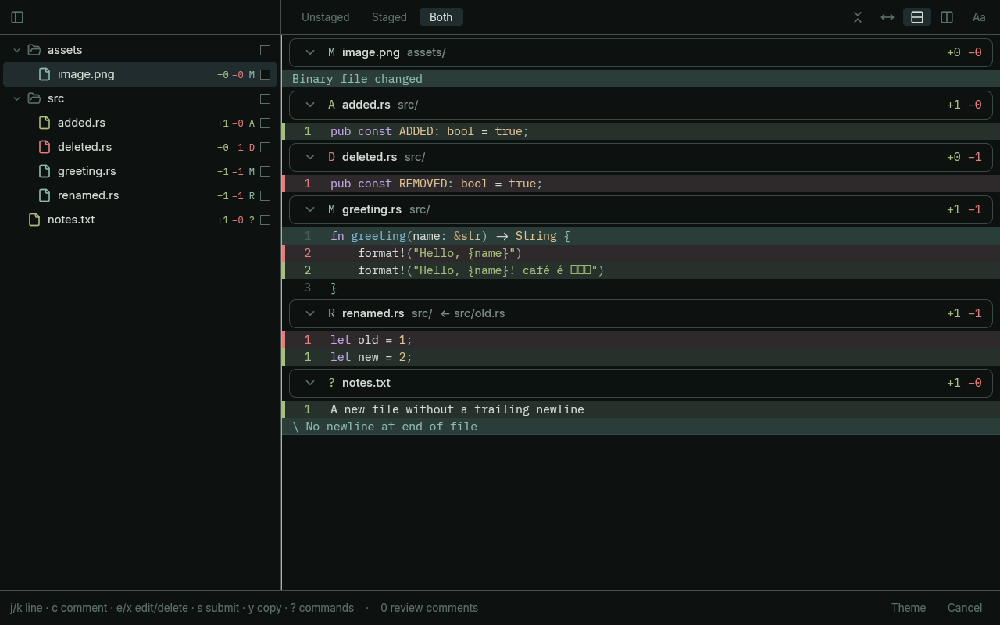
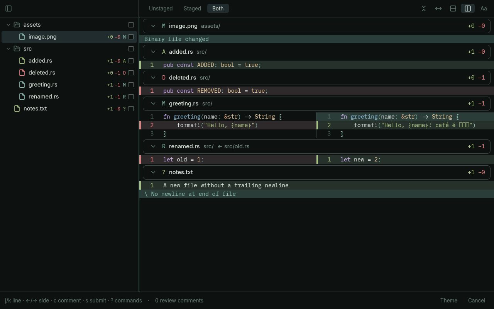
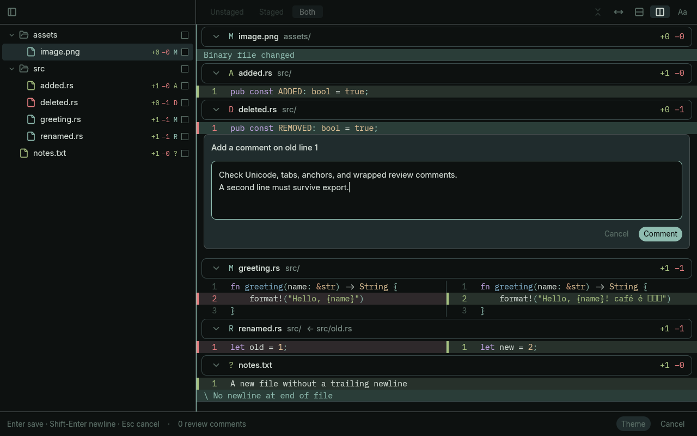
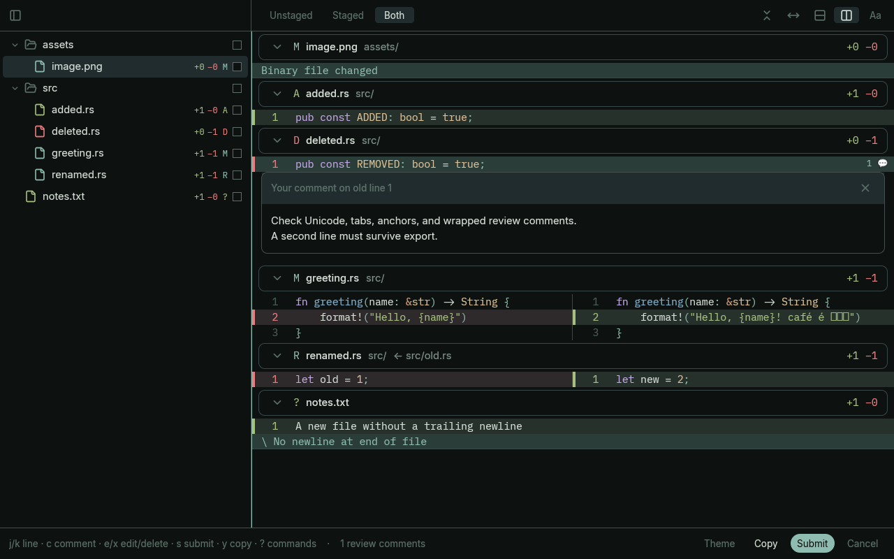
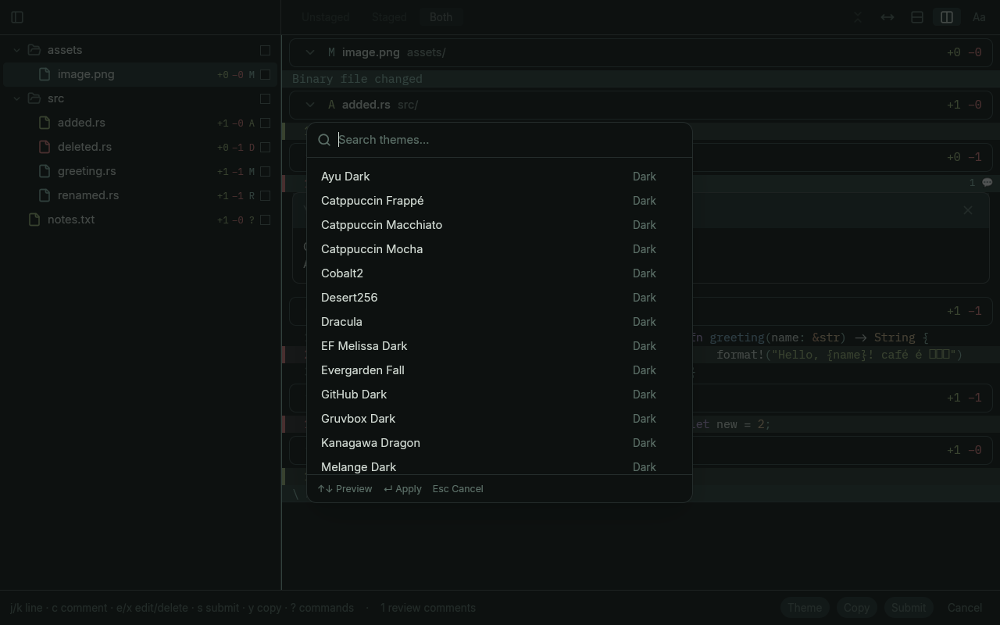
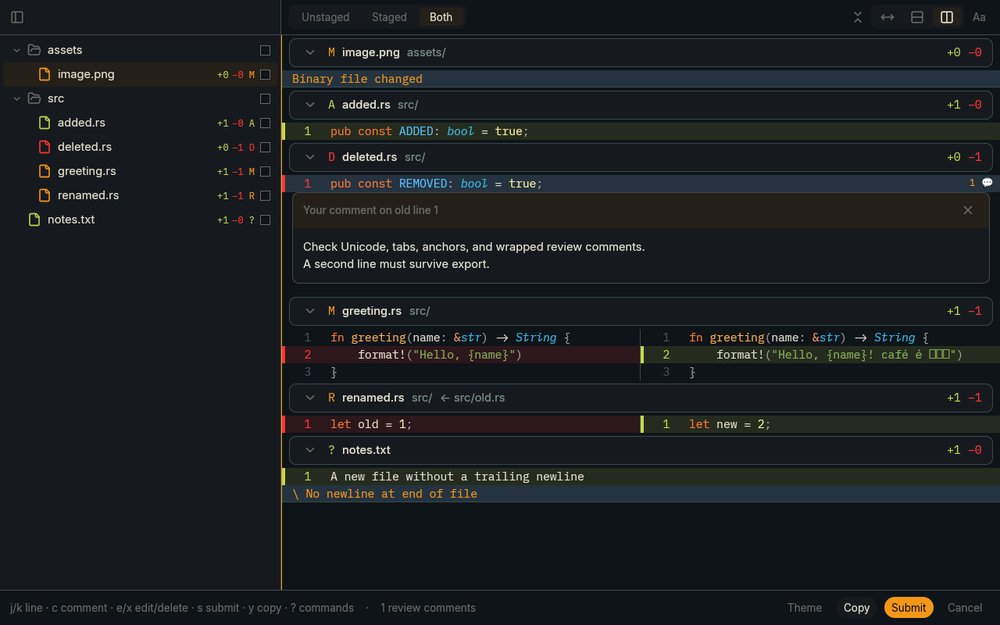
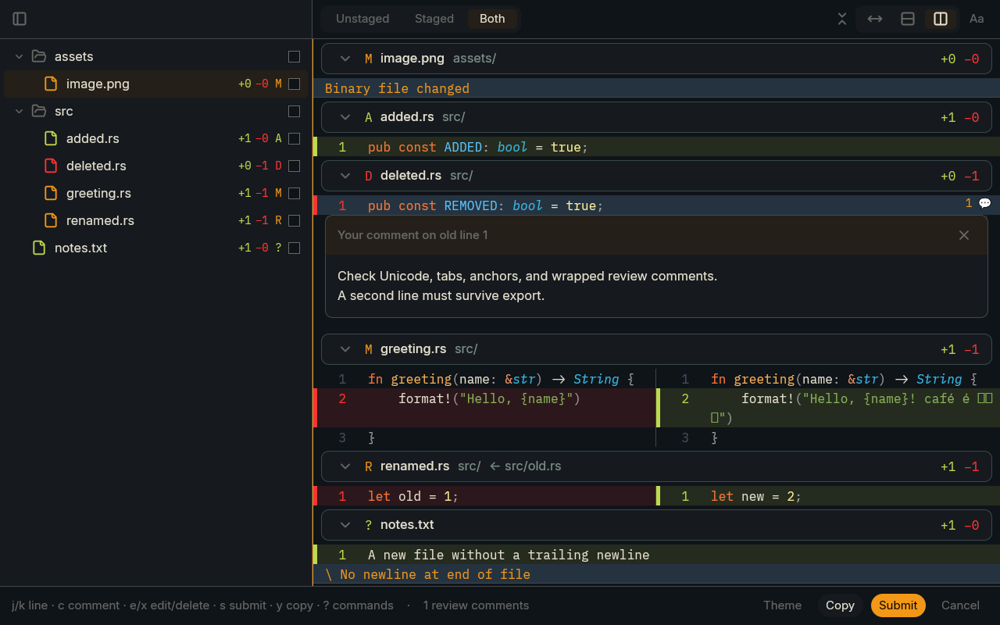
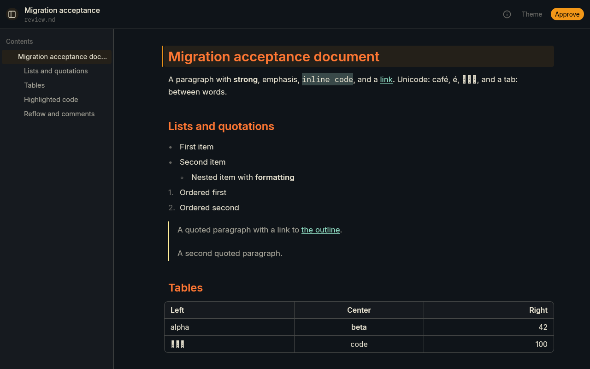

# Browser baseline screenshots

Release production application at `09a11f7e7fbaa354a2df4743b4ee18ede000a30c`; Chromium, 1280×800, DPR 1. See [results](browser/results.json) for exact hashes and [console](browser/console.json) for the actual WebGL2/SwiftShader backend.

All eight files have the expected dimensions, nontrivial pixel variation and distinct hashes. These automated checks do not replace human visual signoff or native OS screenshots.

## diff-unified

Small six-file fixture, sage theme, unified patch layout at the Linux/WASM default interface size (18).

## diff-split

The same document in split layout, preserving source-side semantics and file navigation.

## comment-draft

New multiline comment entered through real browser text input after a public begin-comment command.

## comment-thread

Submitted inline comment thread. Copy/submit events are asserted to retain the second line of the comment.

## theme-picker

Production theme-picker overlay after opening it through the review command API.

## theme-ayu-dark

The same review with the built-in ayu-dark theme after dismissing the picker.

## interface-size-20

Two Control+= actions from the Linux/WASM default (18), producing the expected 20 interface size. This is an action-derived label; no private application state probe was added.

## markdown

Production Markdown reviewer loaded from review.md. Only the visible top of the document is captured; full block coverage belongs to the Markdown tests.

